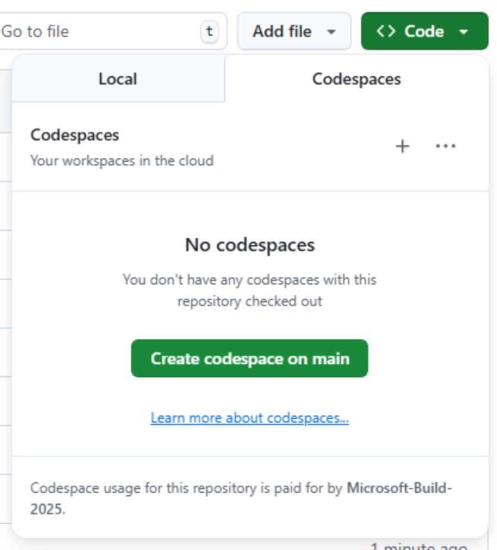

Copilot cloud agent の演習を始める前に、必要な準備をします。Tailspin Toys リポジトリの自分用コピーを作成し、指示ファイルの編集や cloud agent が作成した成果物のレビューに使う [codespace][codespaces] を起動します。

## ハンズオン用リポジトリをセットアップする

作業用のリポジトリを作成するには、[テンプレート][template-repository]から自分用のインスタンスを作ります。作成したインスタンスにはハンズオンに必要なファイルがすべて含まれており、演習を進める際に使用します。

1. 新しいブラウザーウィンドウで [Tailspin Toys のテンプレート][tailspin-template]に移動します。
2. ハンズオン用リポジトリのページで **Use this template** ボタンを選択し、**Create a new repository** を選択してリポジトリのコピーを作成します。

    

3. GitHub または Microsoft が主催するイベントの一環としてワークショップに参加する場合は、メンターの指示に従ってください。それ以外の場合は、GitHub Copilot を利用できる組織に新しいリポジトリを作成できます。

    

4. 作成したリポジトリのパス（**organization-or-user-name/repository-name**）をメモします。ハンズオンの後半で使用します。
## codespace を作成する

続いて、codespace を使って演習を行います。

[GitHub Codespaces][codespaces] は、ブラウザーから直接コードの記述、実行、デバッグができるクラウド開発環境です。複数のプログラミング言語、拡張機能、ツールに対応した、機能豊富な IDE を利用できます。

1. 新しく作成したリポジトリに移動します。
2. 緑色の **Code** ボタンを選択します。

    

3. **Codespaces** タブを選択し、**+** ボタンを選択して新しい Codespace を作成します。

    

codespace の作成には数分かかりますが、サービスをすべて手動でインストールするよりはるかに早く完了します。その間に GitHub Copilot のほかの機能を試してみましょう。次のレッスンで詳しく説明します。

> [!CAUTION]
> 今後の演習でこの codespace に戻ります。それまでは、ブラウザーのタブで開いたままにしてください。

> [!NOTE]
> このワークショップは、codespace またはローカルの [dev container][dev-containers] 内で実行できるように構成されています。どちらもスムーズに作業できるよう、必要な前提条件がすべてインストールされます。ローカルで実行する場合は、クローンしたリポジトリを VS Code で開き、プロンプトが表示されたら **Reopen in Container** を選択してください。codespace と同じ dev container が VS Code によって構築されます。

[codespaces]: https://github.com/features/codespaces
[dev-containers]: https://code.visualstudio.com/docs/devcontainers/containers
## まとめ

ハンズオン用リポジトリのコピーを作成し、Copilot cloud agent と一緒に作業するための codespace の作成を開始しました。

## 次のステップ

cloud agent が従うカスタム指示を追加します。[演習 1 - カスタム指示][next-lesson]に進みます。

## リソース

- [GitHub Codespaces の概要][codespaces]
- [テンプレートからリポジトリを作成する][template-repository]
- [Codespaces を使い始める][codespaces-quickstart]

[tailspin-template]: https://github.com/github-samples/tailspin-toys
[template-repository]: https://docs.github.com/repositories/creating-and-managing-repositories/creating-a-template-repository
[codespaces-quickstart]: https://docs.github.com/codespaces/getting-started/quickstart
[next-lesson]: ../1-custom-instructions/
